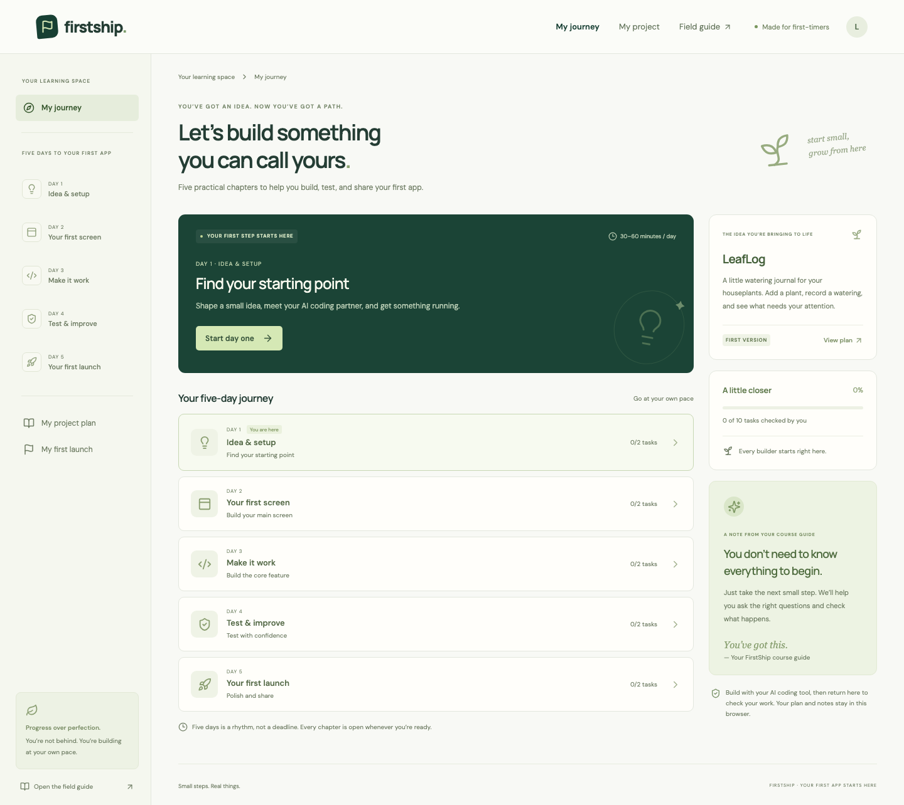
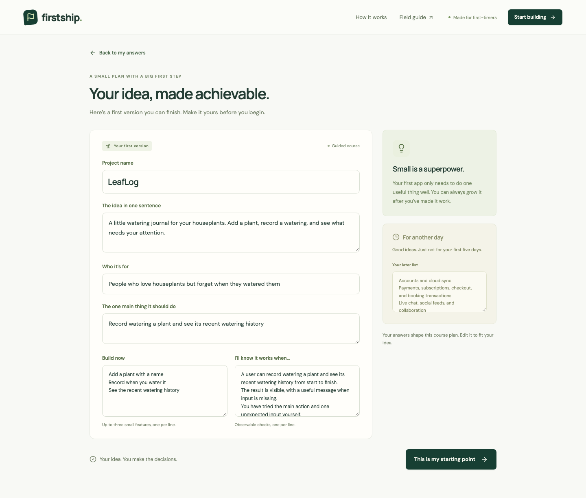
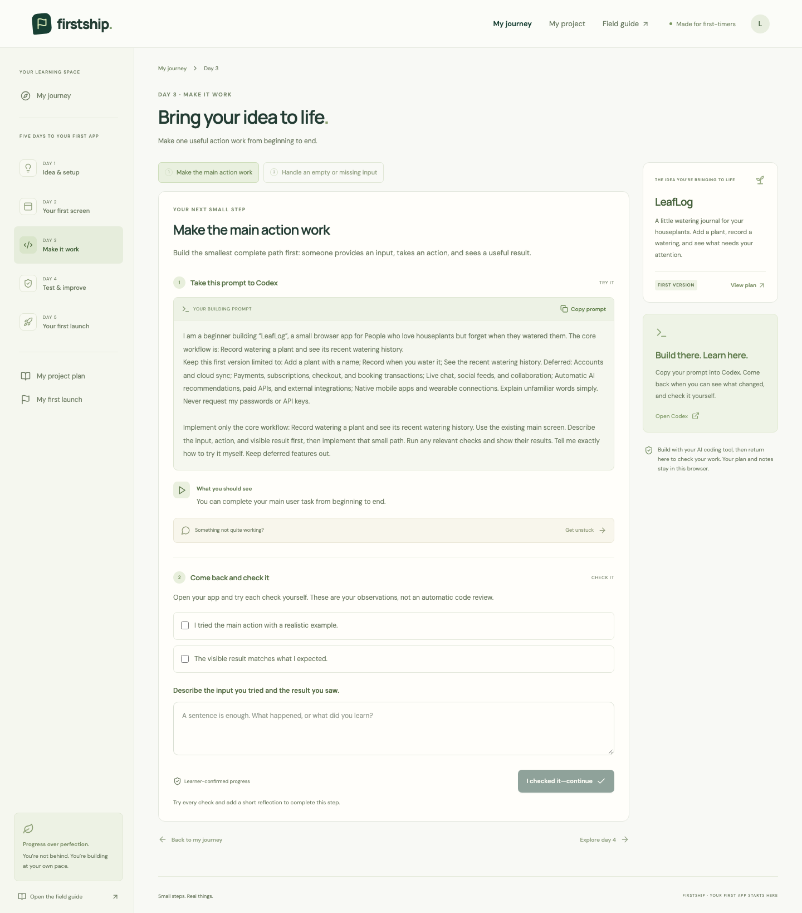
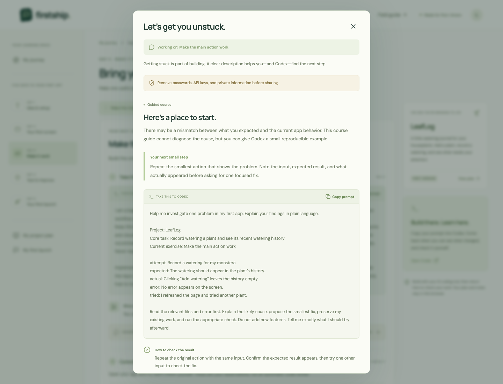
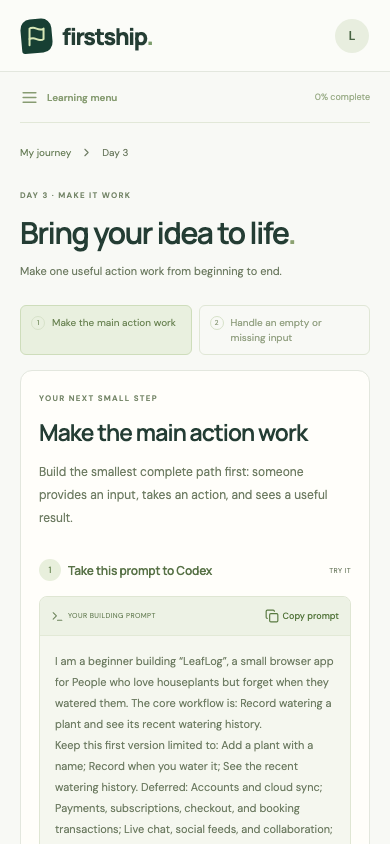
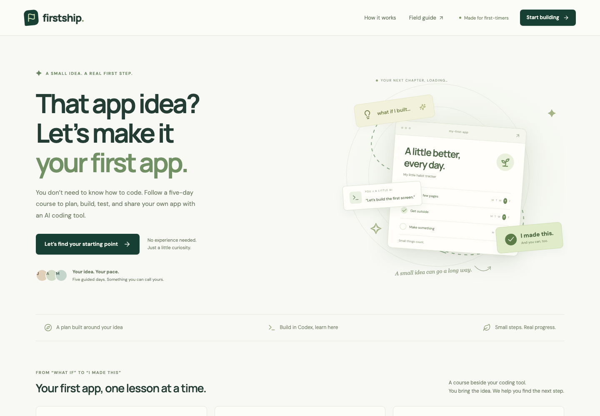

# FirstShip

**Your idea. Your first app. Five guided days.**

FirstShip is a complete guided course for beginners building their own small browser app with an external AI coding tool such as Codex. Turn your idea into an editable, achievable scope, then follow ten practical tasks with project-specific prompts, learner checks, reflections, and troubleshooting.

[**Try FirstShip online**](https://zhoumiaosen.github.io/FirstShip/app/) · [Introduction website](https://zhoumiaosen.github.io/FirstShip/) · [Run locally](#run-locally) · [Screenshots](#screenshots)

Open the course in your browser with no installation or account. All five days are available immediately; five days is a suggested pace. Building your own app happens in a separate coding tool, whose access and setup requirements are separate.



## What you can do

- Bring your own idea and turn it into an editable, achievable first version.
- Follow ten practical tasks across five guided days, with prompts to take to Codex.
- Check the result yourself, record what happened, and keep your progress across visits.
- Turn an error report into a focused investigation prompt for your coding tool.
- Download a summary of your plan, completed tasks, and reflections.

## Screenshots

These are real course captures using **LeafLog**, an illustrative plant-watering project. They show project-specific lessons and troubleshooting with sample data.

<details>
<summary><strong>Turn your own idea into a small, editable plan</strong></summary>



</details>

<details>
<summary><strong>Learn with a task, a prompt, and a clear check</strong></summary>



</details>

<details>
<summary><strong>Find your next step when something goes wrong</strong></summary>



</details>

<details>
<summary><strong>A learning space that works on a small screen</strong></summary>



</details>

<details>
<summary><strong>A welcoming starting point for first-time builders</strong></summary>



</details>

## Run locally

Requires Node.js 22.12+ (Node 24 recommended) and npm.

```sh
npm ci
npm run dev
```

Open http://localhost:5173. The local version provides the same browser-based course as the online version.

Production preview:

```sh
npm run build
npm start
```

The read-only Node preview server binds to loopback and accepts localhost hosts only. Course planning, lessons, troubleshooting, and progress run in the browser; the server serves the app files.

## How the course works

FirstShip combines a structured curriculum with your own project details. The scoping exercise suggests a smaller version of your idea with one main workflow, a few supporting features, observable success checks, and a later list. You edit and approve that plan.

Each lesson explains a useful practice, gives you a task-specific prompt to take to your coding tool, describes the expected result, and asks you to try concrete checks. The troubleshooting exercise organizes what you tried, expected, and observed into a focused investigation prompt. Coding and AI conversations happen separately in Codex or your chosen tool.

Milestones are learner-confirmed. FirstShip does not inspect your local code, run your app, diagnose it automatically, or grade your work. Finishing in five days depends on your scope, setup, and available time; lessons stay open at your own pace.

## Learner journey

1. Describe your idea, audience, main task, experience, and time.
2. Review and edit the reduced scope. Save extra ideas for later.
3. Follow project-specific task cards in any day; copy prompts into Codex.
4. Return, try each check, and record what happened.
5. Use “I'm stuck” to turn an error into a focused investigation prompt.
6. Complete the core tasks, add a safe app or walkthrough link, and export your project summary.

## Data and privacy

One project is saved in this browser's local storage, including idea, plan, reflections, and lesson progress. It is not synced between devices. Export a summary before clearing browser data. Storage failures are shown rather than reported as saved.

Planning and troubleshooting guidance run in your browser. FirstShip does not send your course answers to an AI provider. Anything you separately paste into Codex or another coding tool is handled by that tool. Remove passwords, secrets, personal information, and private code before sharing with any external service.

## Verification

```sh
npm test
npm run build
npx playwright install chromium
npm run test:e2e
npm run build:site
npm run test:site
```

Node tests cover scope variety, completion gates, persistence, URL handling, troubleshooting guidance, and preview-server boundaries. Browser tests cover the learner journey and small-screen navigation. The published-course test follows the introduction link, completes all ten tasks, uses troubleshooting, reloads, exports, and verifies that the course works without backend requests. GitHub Actions runs the relevant checks.

## Online course, introduction website, and screenshots

The introduction site lives in `docs/index.html` with its own stylesheet. It is a standalone static website with no build step or JavaScript. Its **Try FirstShip** links open the complete browser course at `docs/app/`. GitHub Pages publishes the repository's `main` branch from `/docs`.

Rebuild the published course after application changes:

```sh
npm run build:site
```

This creates the browser course in `docs/app/`, including planning, lessons, troubleshooting, browser-local progress, and exports. Commit the generated files when publishing an update.

Preview the website locally:

```sh
python3 -m http.server 4173 --directory docs
```

Then open http://localhost:4173 for the introduction page, or http://localhost:4173/app/ for the course. Run `npm run build:site` first if `docs/app/` is missing or out of date.

To refresh the screenshots, start FirstShip in one terminal, then run this in another:

```sh
npm run screenshots
```

The capture script opens an isolated sample project. It does not change your saved project. `SCREENSHOT_BASE_URL` can point to a different local preview address.

## Source map

- `src/App.jsx`: welcome, onboarding, plan, journey, lessons, help, and summary.
- `src/styles.css`: responsive visual system.
- `src/lib/domain.js`: project-specific curriculum, scope, completion, and export.
- `src/lib/storage.js`: browser-local persistence and recovery.
- `src/lib/guidance.js`: browser-local troubleshooting guidance and error-report prompts.
- `server/index.js`: read-only local development and production preview server.
- `devpost/`: scope, product requirements, technical specification, build checklist.
- `docs/index.html`, `docs/site.css`: static introduction website.
- `docs/screenshots/`: real sample-project screenshots used by the website and README.
- `docs/app/`: generated, published browser course (`npm run build:site`).
- `tests/published-course.spec.js`, `playwright.site.config.js`: published-course browser verification.
- `scripts/capture-screenshots.mjs`: reproducible, isolated screenshot capture.

## Hackathon planning documents

The required planning documents are included in this public repository:

- [Project scope](devpost/scope.md)
- [Product requirements](devpost/prd.md)
- [Technical specification](devpost/spec.md)
- [Build checklist](devpost/checklist.md)

## Hackathon workflow and attribution

Built from a new empty project folder during the hackathon, using the [Devpost Learn Skill Pack](https://github.com/challengepost/learn-ai-basics). Its six installed skills live under `.agents/skills/` and are MIT licensed; see `.agents/skills/DEVPOST-LICENSE`. Planning documents distill decisions made with the learner before implementation. Builder-selected technical defaults are labeled in the specification. Original curriculum material in the app is informed by the linked official guides in the app's resources.

Dependencies include React, Vite, and Lucide icons. No pre-existing application code was imported. AI coding assistants were used for implementation and verification. A public source repository and a separately recorded, publicly accessible demonstration video are required for submission; this repository does not constitute a completed hackathon submission.
